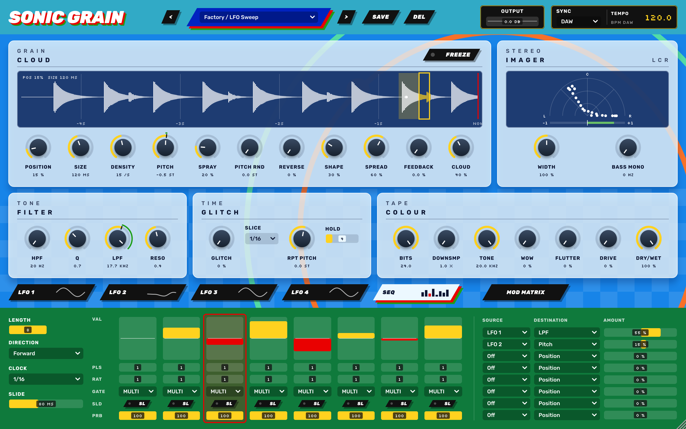
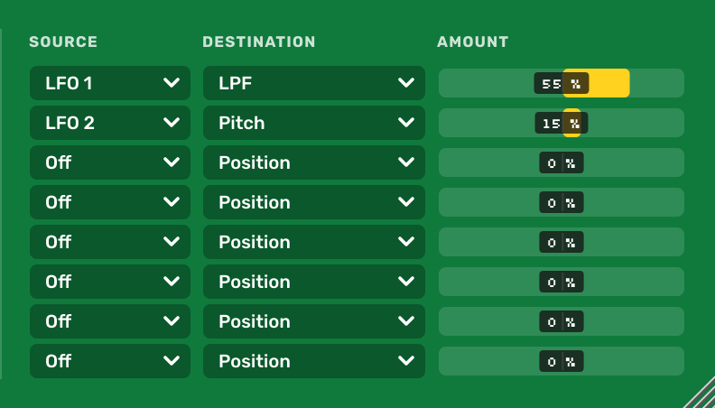

# SONIC GRAIN

Effetto audio granulare, glitch, tape e modulazione, in formato **VST3 / AU / AAX** (C++ / JUCE 8).


## Interfaccia
Dalla 0.2.1: pannelli in vetro su fondo blu, targhe nere inclinate, potenziometri scuri con arco giallo per il valore e valori in carattere pixel. In basso un'area a schede mostra una pagina alla volta (LFO 1–4 o SEQ); la mod matrix resta sempre visibile a destra. Dalla 0.2.2 la finestra si ridimensiona dall'angolo in basso a destra (da 800×500 a 2560×1600, sempre 16:10) e resta nitida a qualunque scala.

| SEQ | Mod matrix |
|---|---|
|  |  |


Modulazione dal vivo: su Pitch la lancetta segue il valore modulato, l'arco verde mostra l'escursione e la tacca scura il valore impostato.

## Funzioni
- **Grains**: granulatore live sugli ultimi 4 s con forma d'onda. La finestra gialla mostra Position/Size, la zona gialla tenue lo Spray, i punti bianchi i grani attivi. Freeze, Density, Pitch, Pitch Rnd, Reverse, Shape, Spread, Feedback, Cloud.
- **Glitch**: repeat a tempo (Slice 1/4 a 1/64), Rpt Pitch, Hold.
- **Filter**: HPF 20 Hz – 2 kHz + Q, LPF 200 Hz – 20 kHz + Reso (SVF 12 dB/oct).
- **Colour**: Bits, Downsample, Tone, Wow, Flutter, Drive, Dry/Wet, Output.
- **Imager**: Width 0–200 % (M/S) e Bass Mono, spettroscopio polare **L C R** con barra di correlazione.
- **Sync**: DAW (segue il playhead dell'host) o FREE (BPM interno 40–240, si trascina il numero nella finestra TEMPO).
- **4 LFO**: 7 forme (S&H e Smooth Rnd mostrano i valori casuali reali, che scorrono), sync a divisioni (8 bar … 1/16T) o 0.02–20 Hz.
- **SEQ**, sequencer ispirato a Intellijel Metropolix: 8 stadi con valore, pulse, ratchet, gate (MULTI / HOLD / SINGLE / REST), slide e probabilità. Direzioni Forward, Reverse, Pendulum, Random e Brownian.
- **Mod matrix** a 8 slot: LFO 1–4, SEQ e SEQ Gate verso 25 destinazioni, amount ±100 %. Potenziometri e valori numerici delle destinazioni seguono la modulazione in tempo reale: l'arco verde mostra l'escursione (giallo nell'area di modulazione), la tacca il valore impostato. Il parametro salvato non cambia e tenendo premuto il potenziometro si vede il valore impostato.
- **Preset**: 8 di fabbrica (anche come program dell'host) più preset utente in `~/Music/Sonic Grain Presets/*.sgpreset`.

Interfaccia 16:10 ridimensionabile (1280×800 di base): pannelli in vetro, LFO e sequencer in un'area a schede, mod matrix sempre visibile. Font Rubik e Silkscreen (SIL Open Font License) incorporati da `Resources/fonts`.

## Download
Ogni tag `v*` pubblica una [Release](../../releases) con:
- macOS: installer `.pkg` con VST3 e AU, oppure VST3, AU e AAX non firmato in zip (universal arm64 + x86_64, da macOS 10.13 High Sierra);
- Windows: VST3;
- Linux: VST3.

**macOS**: le build non sono firmate con un Developer ID né notarizzate, quindi macOS le blocca come file scaricati da internet. Il modo più semplice è l'installer:
1. Scarica `SonicGrain-…-macOS-Installer.pkg` e aprilo. macOS lo blocca.
2. Vai in Impostazioni di Sistema → Privacy e sicurezza, premi `Apri comunque` e completa l'installazione.
3. In Live fai una nuova scansione dei plugin: in Impostazioni → Plug-in tieni premuto Option e premi `Scansiona`.

L'approvazione serve una volta sola per il pacchetto: i plugin installati non hanno la quarantena. Vanno in `/Library/Audio/Plug-Ins/VST3` e `/Library/Audio/Plug-Ins/Components`. Se avevi copiato a mano una versione precedente in `~/Library/Audio/Plug-Ins`, cancellala.

Se preferisci gli zip, dopo aver copiato i plugin togli la quarantena dal Terminale, perché `Apri comunque` può non bastare per un VST3:
```bash
xattr -dr com.apple.quarantine ~/Library/Audio/Plug-Ins/VST3/"SONIC GRAIN.vst3" ~/Library/Audio/Plug-Ins/Components/"SONIC GRAIN.component"
```

## Compilare
Servono CMake ≥ 3.22, un compilatore C++17 e git. JUCE 8.0.10 viene scaricato in automatico; per usarne una copia locale aggiungi `-DJUCE_DIR=/percorso/JUCE`.

```bash
cmake -B build -DCMAKE_BUILD_TYPE=Release            # -DSONICGRAIN_BUILD_AAX=ON  -DSONICGRAIN_BUILD_TESTS=ON
cmake --build build --config Release
```
- I plugin vengono copiati nelle cartelle plug-in dell'utente (si disattiva con `-DSONICGRAIN_COPY_AFTER_BUILD=OFF`).
- **Mac senza Terminale**: doppio clic su `scripts/build-mac.command`, poi `scripts/verify-au.command` per auval.
- **Linux**: servono i pacchetti di sviluppo di JUCE (ALSA, X11, freetype, fontconfig, GL, GTK3); vedi `.github/workflows/ci.yml`.

### Test
```bash
cmake -B build -DSONICGRAIN_BUILD_TESTS=ON && cmake --build build --config Release
build/Tests/SonicGrainTests_artefacts/Release/SonicGrainTests          # test headless
build/Tests/SonicGrainTests_artefacts/Release/SonicGrainTests --snap   # render dell'editor in snap_sonic.png
```

## CI
`.github/workflows/ci.yml`, a ogni push su `main` e a ogni pull request:
- **Linux**: build, test, pluginval livello 8;
- **macOS**: build universal VST3/AU/AAX, test, auval, pluginval;
- **Windows**: build VST3, test, pluginval.

Un tag `vX.Y.Z` crea la Release con gli zip e le note prese da `CHANGELOG.md`.

## Struttura
| Percorso | Contenuto |
|---|---|
| `Source/SonicEngine.h` | motore granulare, glitch, colour, filtri SVF |
| `Source/ModSources.h` | LFO e sequencer METRO |
| `Source/Presets.h` | preset di fabbrica e preset utente |
| `Source/SonicProcessor.*` | parametri, clock DAW/FREE, mod matrix, imager |
| `Source/SonicUI.h`, `Source/SonicEditor.h` | look and feel, forma d'onda, scope LCR, schede di modulazione, layout |
| `Resources/fonts/` | font dell'interfaccia e relative licenze OFL |
| `Source/IDMLookAndFeel.h` | helper per i parametri |
| `Tests/` | test headless e snapshot dell'editor |

## Licenza
JUCE 8 è distribuito sotto AGPLv3 o licenza commerciale. Per distribuire i binari serve una licenza JUCE commerciale, oppure rilasciare questo codice sotto AGPLv3. VST è un marchio di Steinberg Media Technologies GmbH.
