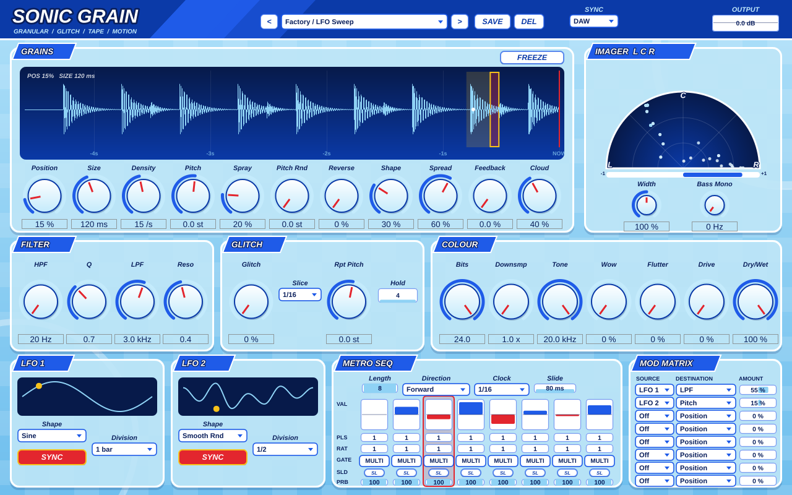

# SONIC GRAIN

Effetto audio granulare, glitch, tape e modulazione, in formato **VST3 / AU / AAX** (C++ / JUCE 8).



## Funzioni
- **Grains**: granulatore live sugli ultimi 4 s con forma d'onda. La finestra rossa/oro mostra Position/Size, l'oro lo Spray, i punti bianchi i grani attivi. Freeze, Density, Pitch, Pitch Rnd, Reverse, Shape, Spread, Feedback, Cloud.
- **Glitch**: repeat a tempo (Slice 1/4 a 1/64), Rpt Pitch, Hold.
- **Filter**: HPF 20 Hz – 2 kHz + Q, LPF 200 Hz – 20 kHz + Reso (SVF 12 dB/oct).
- **Colour**: Bits, Downsample, Tone, Wow, Flutter, Drive, Dry/Wet, Output.
- **Imager**: Width 0–200 % (M/S) e Bass Mono, spettroscopio polare **L C R** con barra di correlazione.
- **Sync**: DAW (segue il playhead dell'host) o FREE (BPM interno 40–240).
- **2 LFO**: 7 forme, sync a divisioni (8 bar … 1/16T) o 0.02–20 Hz.
- **METRO SEQ**, ispirato a Intellijel Metropolix: 8 stadi con valore, pulse, ratchet, gate (MULTI / HOLD / SINGLE / REST), slide e probabilità. Direzioni Forward, Reverse, Pendulum, Random e Brownian.
- **Mod matrix** a 8 slot: LFO 1, LFO 2, SEQ e SEQ Gate verso 25 destinazioni, amount ±100 %.
- **Preset**: 8 di fabbrica (anche come program dell'host) più preset utente in `~/Music/Sonic Grain Presets/*.sgpreset`.

Interfaccia 1280×800.

## Download
Ogni tag `v*` pubblica una [Release](../../releases) con:
- macOS: VST3, AU e AAX non firmato (universal arm64 + x86_64);
- Windows: VST3;
- Linux: VST3.

**macOS**: le build CI non sono notarizzate. Dopo aver copiato i plugin in `~/Library/Audio/Plug-Ins/VST3` e `~/Library/Audio/Plug-Ins/Components`, togli la quarantena:
```bash
xattr -dr com.apple.quarantine ~/Library/Audio/Plug-Ins/VST3/"SONIC GRAIN.vst3" ~/Library/Audio/Plug-Ins/Components/"SONIC GRAIN.component"
```

## Compilare
Servono CMake ≥ 3.22, un compilatore C++17 e git. JUCE 8.0.10 viene scaricato in automatico; per usarne una copia locale aggiungi `-DJUCE_DIR=/percorso/JUCE`.

```bash
cmake -B build -DCMAKE_BUILD_TYPE=Release            # -DSONICGRAIN_BUILD_AAX=ON  -DSONICGRAIN_BUILD_TESTS=ON
cmake --build build --config Release
```
- I plugin vengono copiati nelle cartelle plug-in dell'utente (si disattiva con `-DSONICGRAIN_COPY_AFTER_BUILD=OFF`).
- **Mac senza Terminale**: doppio clic su `scripts/build-mac.command`, poi `scripts/verify-au.command` per auval.
- **Linux**: servono i pacchetti di sviluppo di JUCE (ALSA, X11, freetype, fontconfig, GL, GTK3); vedi `.github/workflows/ci.yml`.

### Test
```bash
cmake -B build -DSONICGRAIN_BUILD_TESTS=ON && cmake --build build --config Release
build/Tests/SonicGrainTests_artefacts/Release/SonicGrainTests          # test headless
build/Tests/SonicGrainTests_artefacts/Release/SonicGrainTests --snap   # render dell'editor in snap_sonic.png
```

## CI
`.github/workflows/ci.yml`, a ogni push su `main` e a ogni pull request:
- **Linux**: build, test, pluginval livello 8;
- **macOS**: build universal VST3/AU/AAX, test, auval, pluginval;
- **Windows**: build VST3, test, pluginval.

Un tag `vX.Y.Z` crea la Release con gli zip e le note prese da `CHANGELOG.md`.

## Struttura
| Percorso | Contenuto |
|---|---|
| `Source/SonicEngine.h` | motore granulare, glitch, colour, filtri SVF |
| `Source/ModSources.h` | LFO e sequencer METRO |
| `Source/Presets.h` | preset di fabbrica e preset utente |
| `Source/SonicProcessor.*` | parametri, clock DAW/FREE, mod matrix, imager |
| `Source/SonicUI.h`, `Source/SonicEditor.h` | look and feel, forma d'onda, scope LCR, layout |
| `Source/IDMLookAndFeel.h` | helper per i parametri |
| `Tests/` | test headless e snapshot dell'editor |

## Licenza
JUCE 8 è distribuito sotto AGPLv3 o licenza commerciale. Per distribuire i binari serve una licenza JUCE commerciale, oppure rilasciare questo codice sotto AGPLv3. VST è un marchio di Steinberg Media Technologies GmbH.
